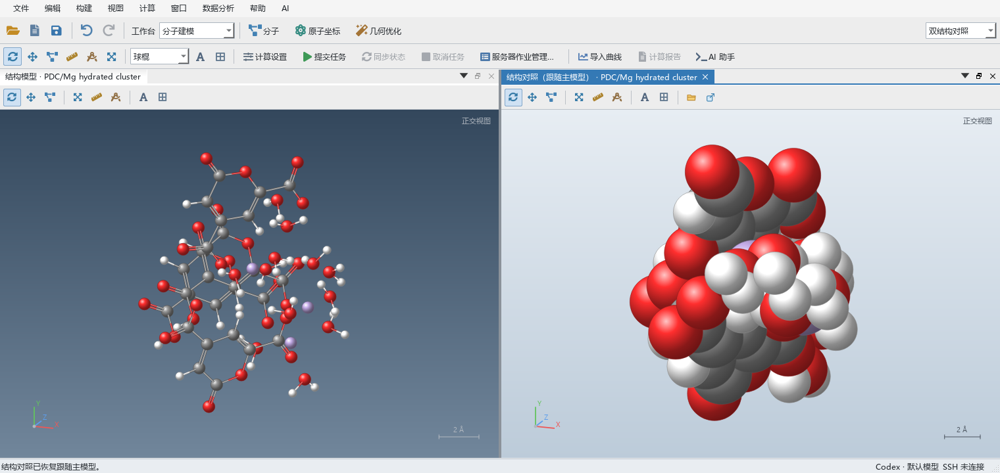

<h1 align="center">ChatDFT</h1>

A Windows workbench for molecular modeling and quantum chemistry

  <strong><a href="https://github.com/shaoyinzi654-source/ChatDFT/releases/download/v5.8.0-standalone/ChatDFT-Standalone-5.8.0-Windows.zip">Download Windows 5.8.0</a></strong>
  &nbsp;·&nbsp; <a href="#getting-started">Install</a>
  &nbsp;·&nbsp; <a href="docs/gallery.md">Gallery</a>
  &nbsp;·&nbsp; <a href="README.md">中文</a>

**PDC–magnesium hydration cluster** · 101 atoms across 19 molecular and ionic fragments. Ball-and-stick at left, space-filling at right. [View the rotation demo](docs/gallery.md#视角演示)

## From structure to results

| Step | What you can do |
| --- | --- |
| Build a structure | Build from SMILES or import XYZ and nonperiodic XSD. Assemble molecules, ions, and explicit water. Edit coordinates and measure distances and angles. |
| Submit a calculation | Run PySCF single-point, geometry optimization, harmonic frequency, and vertical excitation jobs over SSH. Use gas-phase or IEF-PCM solvent settings. |
| Manage jobs | Inspect queues and logs, cancel or retry jobs, and reopen archived inputs, results, and project folders. |
| Inspect and export | Export XYZ, JSON, CSV, PNG, SVG, and Markdown reports. Inspect SCF convergence, frequencies, or geometry changes as applicable. |
| Automate the workflow | Use local Codex or a compatible API to plan structures and jobs, clarify missing inputs, and prepare figures and reports from completed calculations. |
| Work from papers | Extract modeling conditions from papers. The [GROMACS guide](standalone/PDC-MD-GUIDE.md) covers building and analyzing periodic PDC solutions. |

## Calculation example

**Hydrated CO₂–monoethanolamine cluster** · 40 atoms, gas-phase PBE0/def2-SVP single point. The panels show the SCF energy, Mulliken atomic charges, and alpha-channel frontier orbitals.

[Workbench screenshot and charge analysis for this job](docs/gallery.md#计算与分析)

## Getting started

1. Install **64-bit Python 3.13** and extract the Windows package.
2. Run `.Install-ChatDFT.ps1` in PowerShell from the extracted directory and open the desktop shortcut.
3. Choose **构建 → 从 SMILES 建模** (Build from SMILES) and enter `O` to view a water molecule. To calculate, configure your PySCF server under **计算 → 连接与模型设置** (Connection and Model Settings).

[Run the water dimer example](docs/examples/water-dimer/) · [Download example XYZ](docs/examples/water-dimer/water-dimer.xyz?raw=1) · [Workbench manual](standalone/README.md)

## Gallery

  
  &nbsp;
  

[Full gallery](docs/gallery.md) · [Project library and reports](docs/gallery.md#项目与报告)

---

[Source](standalone/) · [Releases](https://github.com/shaoyinzi654-source/ChatDFT/releases) · [Issues](https://github.com/shaoyinzi654-source/ChatDFT/issues) · [Website](https://chatdft.com/) · [License](LICENSE) · [Third-party notices](standalone/OPEN_SOURCE.md) · [Browser archive](legacy/browser/)
