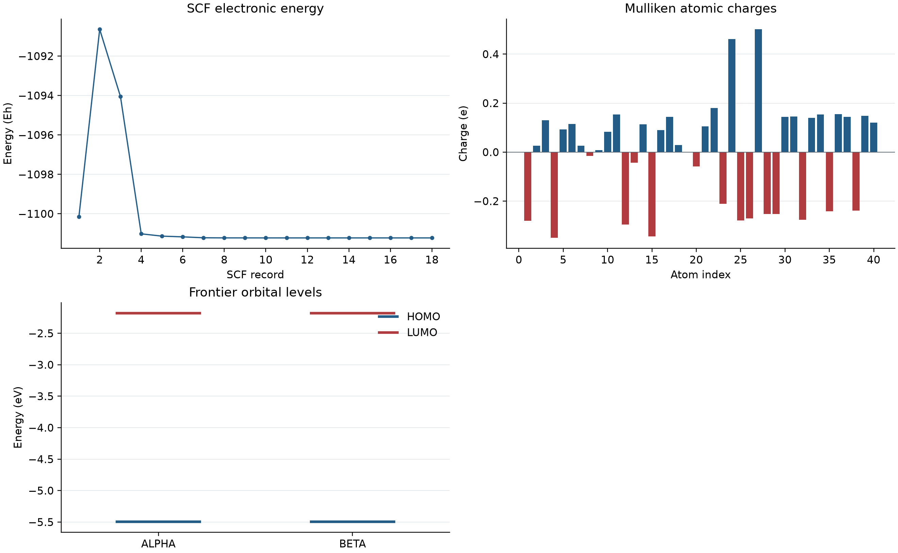

# ChatDFT

**Scientific computing for chemistry on Windows.** Build molecules in 3D, run PySCF calculations, and export reproducible results.

**[Download Windows 5.8.0](https://github.com/shaoyinzi654-source/ChatDFT/releases/download/v5.8.0-standalone/ChatDFT-Standalone-5.8.0-Windows.zip)** · [Workflow guide](docs/workflow.md) · [中文](README.md)

### Workbench gallery

  
  
  
  

[Full gallery and feature list](README.md#实机图集) · [View exported geometry](docs/images/hydrated-cluster-geometry.png) · [View the fragment charge figure](docs/images/fragment-charge.png)

### Model, calculate, and share results

**Model** · Build molecules or clusters from SMILES, XYZ, nonperiodic XSD, or an AI prompt. Edit coordinates and compare geometries in 3D.

**Calculate** · Submit single-point, optimization, frequency, or vertical excitation jobs to a PySCF server over SSH and follow their progress.

**Export** · Keep raw results, coordinates, CSV tables, PNG and SVG figures, and reports. Reopen any saved job from the project library.

### Install and run

1. Extract the [Windows package](https://github.com/shaoyinzi654-source/ChatDFT/releases/download/v5.8.0-standalone/ChatDFT-Standalone-5.8.0-Windows.zip) and install **64-bit Python 3.13**.
2. Run `.\Install-ChatDFT.ps1` in PowerShell from the extracted folder, then open the ChatDFT desktop shortcut.
3. Choose **构建 → 从 SMILES 建模** (Build from SMILES) and enter `O` to view water. Configure your PySCF server under **计算 → 连接与模型设置** (Connection and model settings) before submitting a job.

### Project links

[Windows source](standalone/) · [Releases](https://github.com/shaoyinzi654-source/ChatDFT/releases) · [PDC simulations](standalone/PDC-MD-GUIDE.md) · [Browser archive](legacy/browser/) · [License](LICENSE)

[Project website](https://chatdft.com/) · [Report an issue](https://github.com/shaoyinzi654-source/ChatDFT/issues) · [Third-party notices](standalone/OPEN_SOURCE.md)
