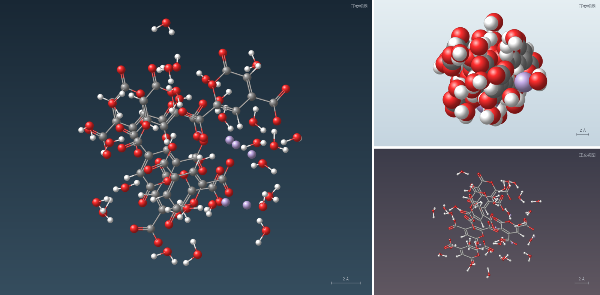
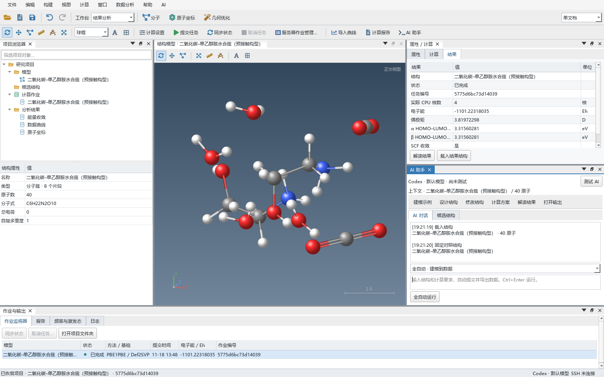

[](#complex-system-demos)

**[Download Windows 5.8.0](https://github.com/shaoyinzi654-source/ChatDFT/releases/download/v5.8.0-standalone/ChatDFT-Standalone-5.8.0-Windows.zip)** · [Open the demo](#complex-system-demos) · [See a completed job](#completed-calculation) · [Documentation](#documentation-and-support) · [中文](README.md)

Import or assemble molecules, submit PySCF jobs over SSH, and archive geometries, values, figures, and reports.

## Complex-system demos

Six PDC dianions, six Mg²⁺ ions, and 30 water molecules form a neutral singlet starting geometry. The project retains the fragment identities, bonds, and assembly recipe. Open it to change representations, check atom-to-atom distances, and prepare a calculation at your chosen level of theory.

| Assembly step | Verified starting geometry |
| --- | --- |
| Arrange PDC | Two heavy-atom plane pairs with normal separations of 3.60 Å |
| Add magnesium | Five specified PDC oxygen to Mg distances of 2.25 Å |
| Add explicit water | Five specified water oxygen to Mg distances of 2.30 Å |

[Download the ChatDFT project](docs/examples/pdc-hydration-assembly/pdc-hydration.chatdft.json?raw=1) · [Download XYZ](docs/examples/pdc-hydration-assembly/pdc-hydration.xyz?raw=1) · [Recipe and rotation](docs/examples/pdc-hydration-assembly/)

<details>
<summary>Compare ball-and-stick, space-filling, and stick views in ChatDFT</summary>

[](docs/images/pdc-hydration-assembly.png)

</details>

## Completed calculation

### Hydrated CO₂–monoethanolamine cluster

The archived job used a **40-atom, neutral singlet** cluster. PySCF ran a **gas-phase PBE0/def2-SVP single-point calculation** at the supplied geometry.

[](docs/images/workbench-5.8.png)

| Action | What to inspect |
| --- | --- |
| Open the structure | Confirm atom count, total charge, spin multiplicity, and active model. |
| Review the calculation settings | Check PBE0, def2-SVP, gas phase, and single-point energy. |
| Read the result | Review SCF convergence, electronic energy, dipole moment, and the frontier orbital gap. |
| Reopen the archived job | Use the project library for the available coordinates, outputs, figures, and report. |

<p>
  <a href="docs/images/hydrated-cluster-geometry.png"></a>
  &nbsp;
  <a href="docs/images/fragment-charge.png"></a>
</p>

The left panel shows the XYZ geometry. The right panel groups Mulliken atomic charges by molecular fragment. To assess whether the structure is stable, continue with geometry optimization and vibrational analysis.

[Find the job figures in the gallery](docs/gallery.md#计算与分析) · [Full SCF, charge, and orbital plots](docs/images/calculation-output.png)

## From structure to results

Load a structure locally, choose calculation settings, and submit a PySCF job over SSH. When results sync back, compare geometries, review convergence and numerical output, and reopen the job files from the project library.

| If you want to… | Start here |
| --- | --- |
| Inspect a multi-fragment structure | [Open the 186-atom project](#complex-system-demos) |
| Follow a completed job from input to output | [CO₂–monoethanolamine cluster](#completed-calculation) |
| Check a supported task, format, or tool | [Features and workflows](#features-and-workflows) |
| Find server settings, output files, or the paper workflow | [Documentation and support](#documentation-and-support) |

## Features and workflows

### Molecular modeling

Generate 3D conformers from SMILES or import XYZ and nonperiodic XSD. Edit atomic coordinates, charge, and multiplicity, set initial distances in multi-fragment structures, and measure distances, angles, and dihedrals. Pin a comparison structure and switch each view between ball-and-stick, sticks, wireframe, and space filling.

[Dual-view walkthrough](docs/gallery.md#视角演示)

### Quantum chemistry

| PySCF task | Typical results |
| --- | --- |
| Single-point energy | Electronic energy at the supplied geometry, SCF records, and available charges and orbitals |
| Geometry optimization | Optimized coordinates, convergence, and changes from the starting structure |
| Harmonic frequencies or optimization plus frequencies | Vibrational frequencies and available spectra |
| Vertical excitation | Excitation energies and related output at the supplied geometry |

Applicable jobs support gas-phase and IEF-PCM settings. The workbench can sync, cancel, or retry jobs. Existing DOS or spectral data can be imported as CSV.

### AI and automation

Connect a local Codex login or a compatible API. Ask for a new structure, a geometry edit, or calculation settings. The automated workflow can submit a calculation after validating the model. Answer follow-up questions in the same session if more input is needed.

<details>
<summary>Show a copyable automation prompt</summary>

```text
全自动：从 SMILES O 建立单个水分子，电荷 0，多重度 1。
执行气相 HF/STO-3G 单点能，归档电子能、偶极矩、原子电荷、结构图和报告。
```

</details>

[Automation workflow and further examples](docs/workflow.md)

### Jobs and projects

The job monitor shows status, method, basis, and available results. Use the project library to reopen initial and final structures, the output folder, logs, and saved reports. Base figures are archived with each job. Supplemental analysis keeps versioned figures and reports for the selected output.

[](docs/gallery.md#项目与报告)

### Papers and periodic systems

The molecular paper workflow can extract methods, basis sets, molecular settings, and cited pages from PDF, TXT, or Markdown. The GROMACS workflow covers periodic PDC solution boxes, trajectories, and aggregation analysis. Check the original coordinates, force-field parameters, and conditions before reproducing a study.

[Paper workflow](standalone/README.md#ai-与服务器) · [PDC molecular dynamics guide](standalone/PDC-MD-GUIDE.md)

## Gallery

[Rotation demo](docs/gallery.md#视角演示) · [Modeling and measurement](docs/gallery.md#建模--modeling) · [Calculation and analysis](docs/gallery.md#计算与分析) · [Project library and report](docs/gallery.md#项目与报告)

## Getting started

1. Install **64-bit Python 3.13**, then download and extract the [Windows 5.8.0 ZIP](https://github.com/shaoyinzi654-source/ChatDFT/releases/download/v5.8.0-standalone/ChatDFT-Standalone-5.8.0-Windows.zip).
2. Open PowerShell in the extracted folder and run the installer. Launch **ChatDFT** from the desktop shortcut.

   ```powershell
   .\Install-ChatDFT.ps1
   ```

3. Configure SSH and the server’s PySCF Python path under **计算 → 连接与模型设置**.

[Water dimer walkthrough](docs/examples/water-dimer/) · [Open the 186-atom project](#complex-system-demos)

## Documentation and support

| Resource | What it covers |
| --- | --- |
| [Workbench manual](standalone/README.md) | Interface, modeling, AI, and server configuration |
| [Automation guide](docs/workflow.md) | Prompts, submitting calculations, and archiving results |
| [Public examples](docs/examples/) | Water dimer inputs and the completed hydrated cluster calculation |
| [Releases](https://github.com/shaoyinzi654-source/ChatDFT/releases) | Windows packages and release history |
| [Issues](https://github.com/shaoyinzi654-source/ChatDFT/issues) | Report a problem with its version, steps, and relevant error |

[Source](standalone/) · [Website](https://chatdft.com/) · [License](LICENSE) · [Third-party notices](standalone/OPEN_SOURCE.md) · [Browser archive](legacy/browser/)
