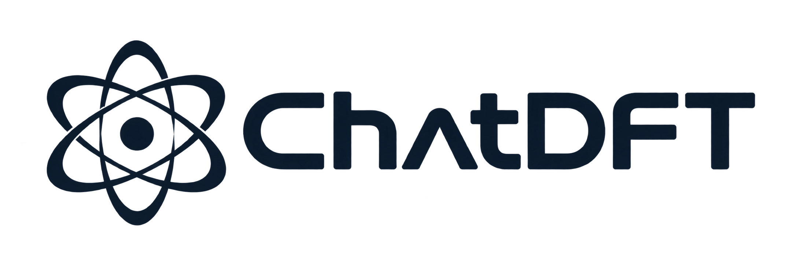
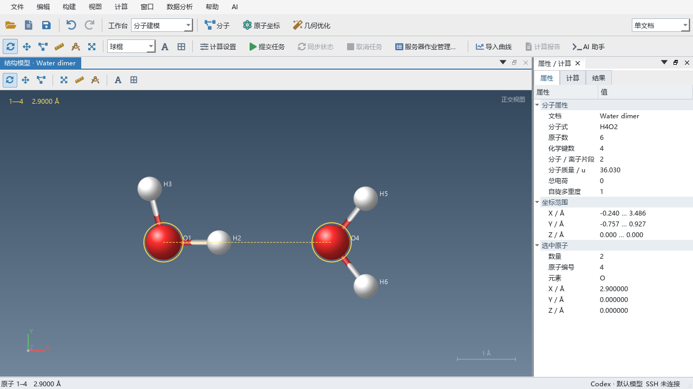
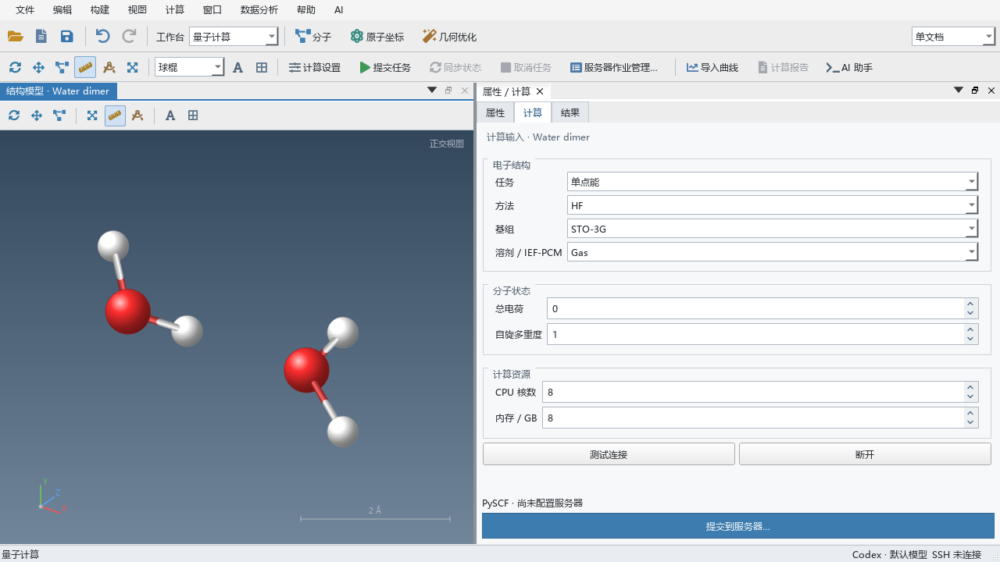
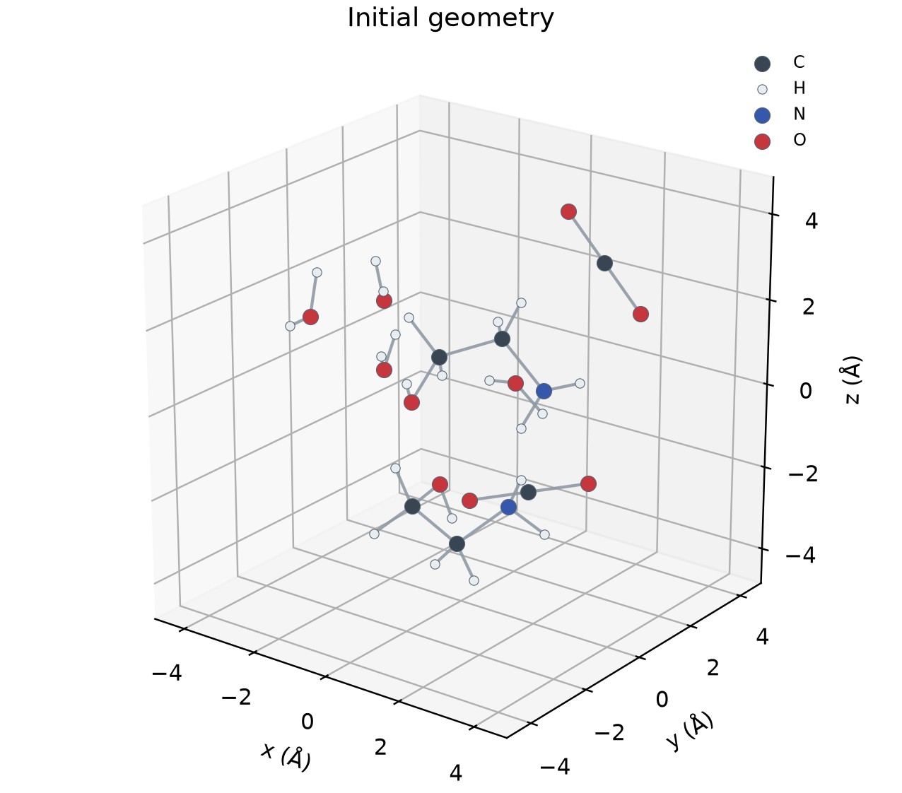
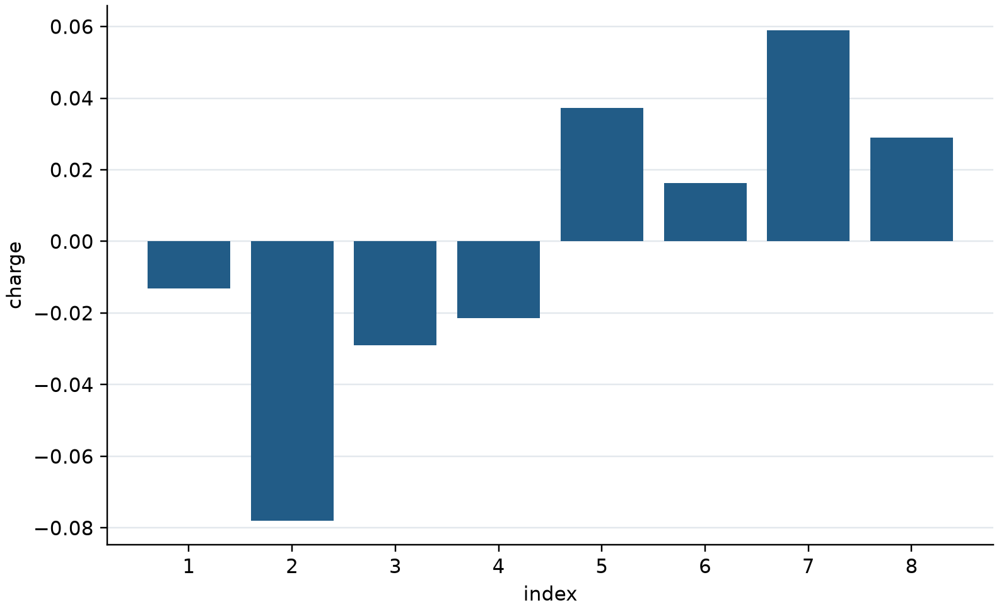
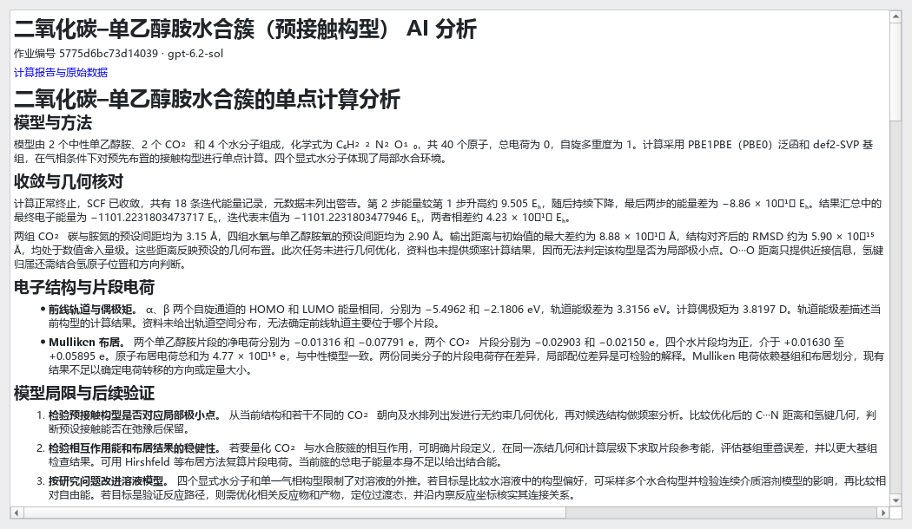
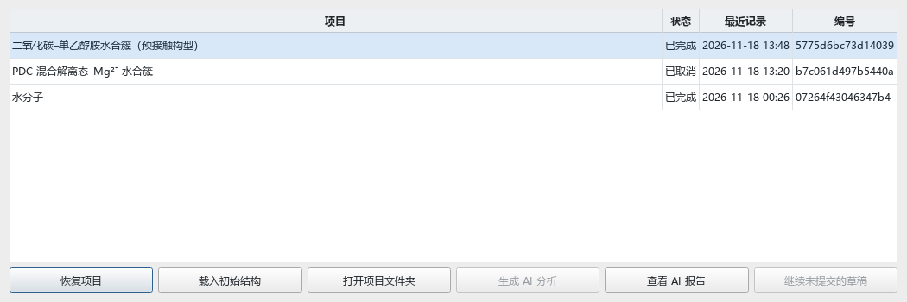

<h1 align="center">
  <picture>
    <source media="(prefers-color-scheme: dark)" srcset="docs/images/wordmark-paper.png">
    
  </picture>
</h1>

<p align="center"><strong>A Windows workbench for molecular modeling and computational chemistry</strong></p>

<p align="center">
  <a href="https://github.com/shaoyinzi654-source/ChatDFT/releases/download/v5.8.0-standalone/ChatDFT-Standalone-5.8.0-Windows.zip"><strong>Download 5.8.0 · Windows x64</strong></a>
  &nbsp;·&nbsp; <a href="#getting-started">Install</a>
  &nbsp;·&nbsp; <a href="#calculation-example">Calculation example</a>
  &nbsp;·&nbsp; <a href="#gallery">Gallery</a>
  &nbsp;·&nbsp; <a href="README.md">中文</a>
</p>

[](docs/gallery.md#视角演示)

*ChatDFT 5.8.0 · Two views of the same PDC–magnesium hydration cluster.* [See the rotation demo](docs/gallery.md#视角演示)

Build and inspect molecules, submit PySCF jobs over SSH, and keep the input, output, and analysis together in each project. ChatDFT supports a manual workflow and an automation mode driven by a natural-language request.

[Modeling](#molecular-modeling) · [Calculations](#quantum-chemistry) · [Results](#calculation-example) · [Automation](#ai-and-automation) · [Projects](#jobs-and-projects) · [Papers and periodic systems](#papers-and-periodic-systems)

## From structure to results

### Molecular modeling

Generate 3D starting geometries from **SMILES** or import **XYZ** and nonperiodic **XSD**. Edit elements, positions, total charge, and spin multiplicity. For a multi-fragment cluster, add solutes, ions, and explicit water and specify initial contacts or stacking arrangements.

[](docs/images/water-dimer-measurement.png)

*Water dimer example · The highlighted atoms are the two oxygen centers.* [Download the example XYZ](docs/examples/water-dimer/water-dimer.xyz?raw=1)

- Measure distances, angles, and dihedrals with atom labels visible.
- See the same structure in ball-and-stick, stick, wireframe, or space-filling views. Rotate or zoom the primary and comparison views independently.
- Pin a reference structure for comparison. Make it the primary structure before submitting a calculation on it.
- Switch among single-document, comparative, four-view, and tabbed layouts. Dock, split, or float the panes.

### Quantum chemistry

The calculation tab shows the primary model and the task, method, basis, solvent, charge, and multiplicity. Jobs run on a configured PySCF server over SSH.

[](docs/images/pyscf-job-setup.png)

| Task | Results to inspect |
| --- | --- |
| Single-point energy | Electronic energy at the input geometry, SCF records, and available charge and orbital data. |
| Geometry optimization | Optimized coordinates, convergence, and changes relative to the input geometry. |
| Harmonic frequencies or optimization plus frequencies | Vibrational frequencies and available spectral data. |
| Vertical excitation | Excitation energies and related results at the supplied geometry. |

Applicable jobs support gas-phase and IEF-PCM solvent settings. Busy servers can queue jobs, and the monitor follows their status. [Server and calculation setup](standalone/README.md#ai-与服务器)

### Calculation example

**Hydrated CO₂–monoethanolamine cluster · gas-phase PBE0/def2-SVP single point.** This 40-atom job illustrates SCF convergence, population analysis, and frontier orbital energies.

[](docs/images/calculation-output.png)

<p>
  <a href="docs/images/hydrated-cluster-geometry.png"></a>
  &nbsp;
  <a href="docs/images/fragment-charge.png"></a>
</p>

*Left, structure plotted from XYZ coordinates. Right, Mulliken charges summed by molecular fragment for the same job.*

Select a job to inspect its numbers, units, log, and structures. Use RMSD, distances, or vibrational frequencies where applicable. Import external DOS or spectroscopy curves as CSV and inspect them in the data-analysis view. [Output file guide](docs/workflow.md#查看输出)

### AI and automation

Use the local Codex login or a compatible API. Request a structure, an edit, or calculation settings independently. Automation mode can validate the model, submit a job, and follow it through export. Answer follow-up questions if inputs are missing, or end the modeling session from the assistant pane.

```text
全自动：新建单个水分子（SMILES O），总电荷 0、单重态。
用 PySCF 做气相 HF/STO-3G 单点能，保存电子能、偶极矩、
原子电荷、结构图和计算报告。
```

Choose a model and test the connection in the AI settings. After a completed run, ChatDFT archives the solver output and base figures. Supplemental analysis uses the job's returned data, saves a separate report version, and sends a desktop notification when finished.

[](docs/images/ai-report.png)

[Automation guide](docs/workflow.md#提交作业) · [Prompt examples](standalone/README.md#一句话建模)

### Jobs and projects

The job monitor shows status, method, basis, and available results. Server job management filters by status, engine, or job ID. It can show logs and resource usage, cancel jobs, and retry failed PySCF jobs using their saved inputs.

[](docs/images/project-library.png)

Open a job in the project library to recover its starting or final structure, open its output folder, or regenerate supplemental analysis.

| Files | Purpose |
| --- | --- |
| `.chatdft.json`, XYZ | Save modeling inputs and selected settings or exchange coordinates. |
| Solver input, logs, and result JSON | Keep a record of the parameters and actual run state. |
| CSV, PNG, SVG, and Markdown | Export tabular data, figures, and reports. |

### Papers and periodic systems

For molecular papers, import PDF, TXT, or Markdown and extract relevant methods, basis sets, charge, spin, and cited pages. Check them against the original coordinates, supplementary materials, and the supported calculation settings.

The GROMACS workflow handles periodic PDC solutions, trajectory management, and aggregation analysis. Reproduction depends on access to the original force-field parameters and the actual simulation conditions. [Paper workflow](standalone/README.md#ai-与服务器) · [PDC molecular dynamics guide](standalone/PDC-MD-GUIDE.md)

## Getting started

1. Install **64-bit Python 3.13** and extract the [Windows 5.8.0 package](https://github.com/shaoyinzi654-source/ChatDFT/releases/download/v5.8.0-standalone/ChatDFT-Standalone-5.8.0-Windows.zip).
2. Run `.Install-ChatDFT.ps1` from the extracted directory in PowerShell, then open the desktop shortcut.
3. Import the [water dimer XYZ](docs/examples/water-dimer/water-dimer.xyz?raw=1) from the File menu or enter `O` under **构建 → 从 SMILES 建模** to view a water molecule.
4. Before submitting a job, configure SSH and the server's PySCF Python path under **计算 → 连接与模型设置**. To use AI, open **AI → 选择模型与设置** and confirm your Codex or API connection.

[Water dimer quickstart](docs/examples/water-dimer/) · [Full workbench manual](standalone/README.md)

## Gallery

[Rotation demo](docs/gallery.md#视角演示) · [Molecular modeling](docs/gallery.md#建模--modeling) · [Calculation and analysis](docs/gallery.md#计算与分析) · [Projects and reports](docs/gallery.md#项目与报告)

---

[Source](standalone/) · [Releases](https://github.com/shaoyinzi654-source/ChatDFT/releases) · [Issues](https://github.com/shaoyinzi654-source/ChatDFT/issues) · [Website](https://chatdft.com/) · [License](LICENSE) · [Third-party notices](standalone/OPEN_SOURCE.md) · [Browser archive](legacy/browser/)
