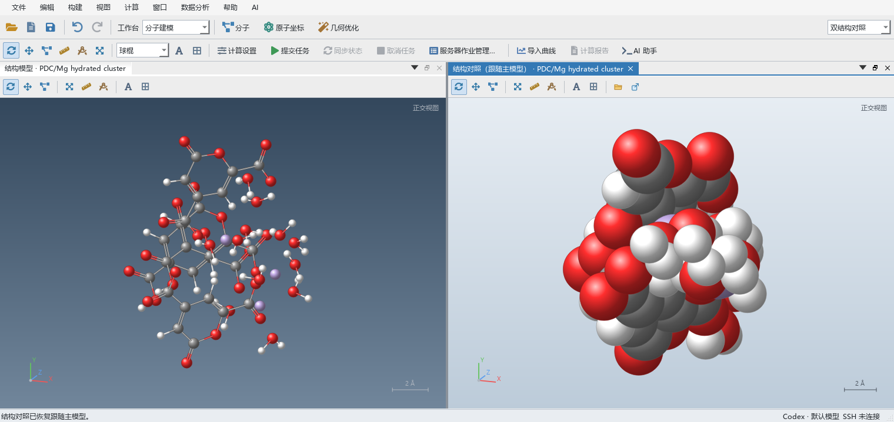
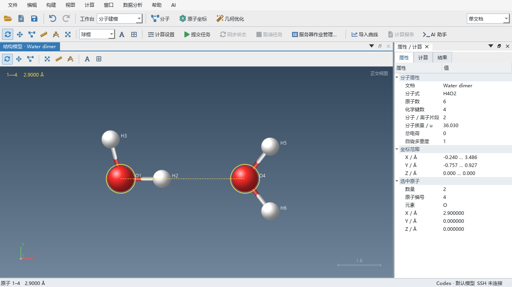
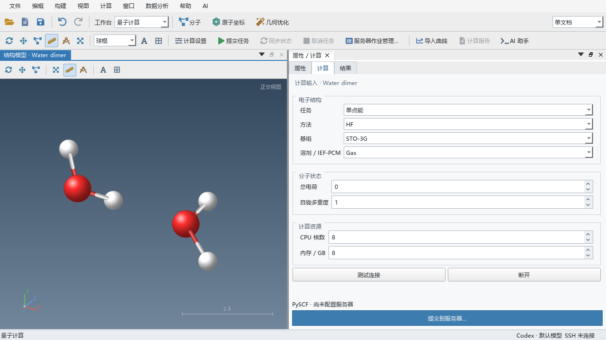
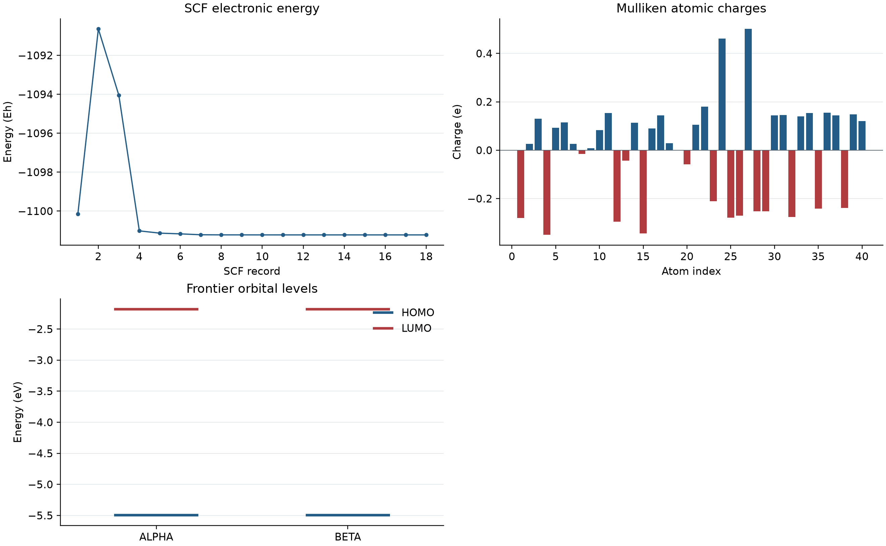
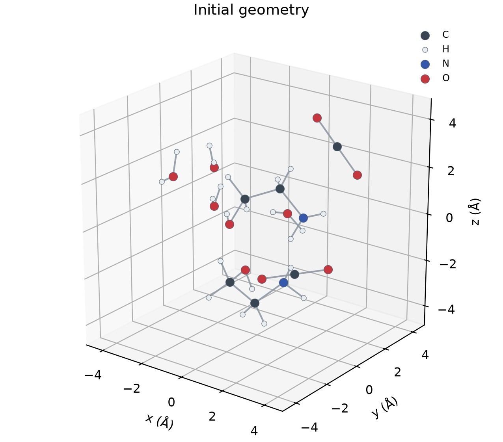
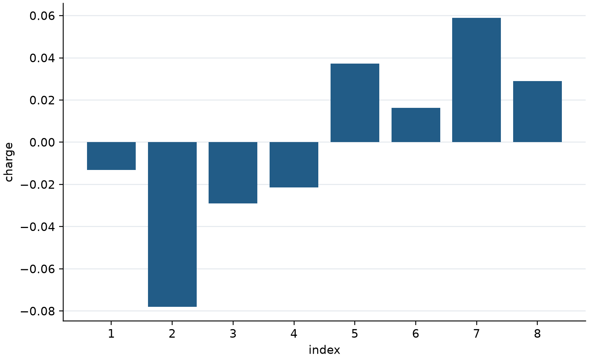
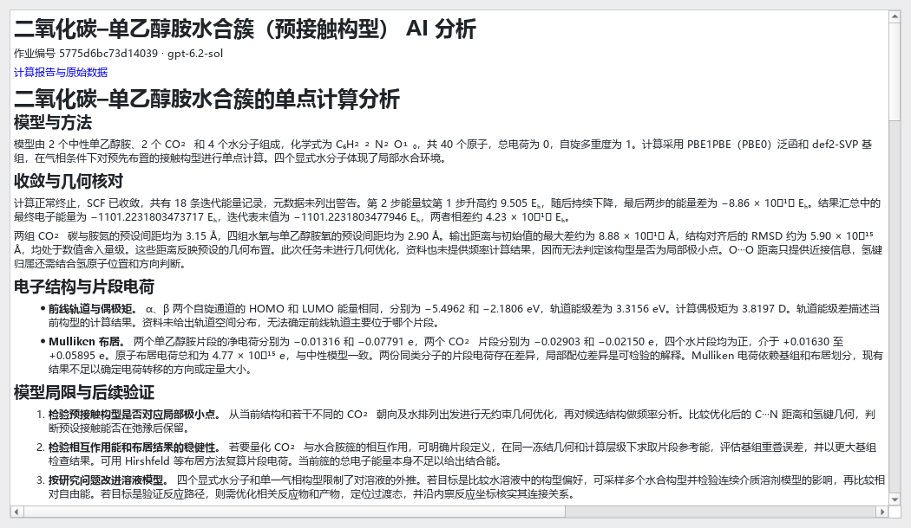
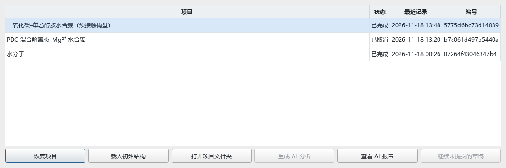

<h1 align="center">
  <picture>
    <source media="(prefers-color-scheme: dark)" srcset="docs/images/wordmark-paper.png">
    
  </picture>
</h1>

<p align="center"><strong>面向计算化学的 Windows 分子工作台</strong></p>

<p align="center">
  <a href="https://github.com/shaoyinzi654-source/ChatDFT/releases/download/v5.8.0-standalone/ChatDFT-Standalone-5.8.0-Windows.zip"><strong>下载 5.8.0 · Windows x64</strong></a>
  &nbsp;·&nbsp; <a href="#安装与上手">安装</a>
  &nbsp;·&nbsp; <a href="#实算案例">实算案例</a>
  &nbsp;·&nbsp; <a href="#实机图集">图集</a>
  &nbsp;·&nbsp; <a href="README.en.md">English</a>
</p>

[](docs/gallery.md#视角演示)

*ChatDFT 5.8.0 · 同一 PDC–镁水合簇的两种显示方式。* [查看旋转演示](docs/gallery.md#视角演示)

ChatDFT 把三维分子建模、PySCF 作业提交、结果分析和项目归档放在同一个桌面工作台。你可以手动构建和计算，也可以在全自动模式中用自然语言描述结构和任务。

[分子建模](#分子建模) · [量子化学计算](#量子化学计算) · [实算案例](#实算案例) · [AI 辅助与全自动计算](#ai-辅助与全自动计算) · [作业与项目](#作业与项目) · [论文与周期体系](#论文与周期体系)

## 从结构到计算结果

### 分子建模

从 **SMILES** 生成三维初始构象，或导入现成的 **XYZ、非周期 XSD**。可以编辑原子元素与坐标、增删原子、设定总电荷及自旋多重度。多分子体系可加入独立的溶质、离子和显式水，并指定片段之间的初始接触距离或堆叠方式。

[](docs/images/water-dimer-measurement.png)

*水二聚体示例 · 通过原子编号检查 O···O 间距。* [下载本例 XYZ](docs/examples/water-dimer/water-dimer.xyz?raw=1)

- **结构检查** · 对照窗口与主模型可以分开旋转和缩放，可切换球棍、棍状、线框和空间填充样式。
- **几何测量** · 在三维视图选原子，测量距离、角度或二面角。坐标可用 Å 单位检查和编辑。
- **对照与切换** · 对照窗口默认跟随主模型，也可固定另一套结构。用 **设为主模型** 将对照结构选为下一次计算的输入。
- **工作区布局** · 单文档适合放大观察，双结构用于比较，四视图可同时查看结构和结果。面板可停靠、拆分或浮动。

### 量子化学计算

在 **计算设置** 核对当前主模型、任务类型、方法、基组、溶剂、电荷和多重度。作业通过 SSH 提交给配置好的 PySCF 服务器。示例以气相 HF/STO-3G 设置演示提交流程。

[](docs/images/pyscf-job-setup.png)

| 任务 | 可查看的输出 |
| --- | --- |
| 单点能 | 给定构型的电子能、SCF 收敛记录，以及作业返回的电荷和轨道结果。 |
| 几何优化 | 优化后的坐标、收敛状态和输入与结果之间的结构变化。 |
| 谐振频率或优化加频率 | 振动频率和计算返回的相关数据，可用来检查虚频。 |
| 垂直激发态 | 在给定几何上的激发能，以及作业返回的相关结果。 |

可为适用任务选择气相或 IEF-PCM 溶剂模型。服务器忙时作业可排队，随后在监视器同步进度。 [服务器配置与作业说明](standalone/README.md#ai-与服务器)

### 实算案例

**CO₂–单乙醇胺水合簇 · PBE0/def2-SVP 气相单点能。** 这个 40 原子示例用于观察电子自洽收敛、核对电荷分布和读取轨道能级。

[](docs/images/calculation-output.png)

<p>
  <a href="docs/images/hydrated-cluster-geometry.png"></a>
  &nbsp;
  <a href="docs/images/fragment-charge.png"></a>
</p>

*左图是 XYZ 几何导出的结构图，右图按分子片段汇总同一次计算的 Mulliken 电荷。*

选中作业即可查看有单位的结果、对应的输入和结果几何，以及日志。视情况可检查前后结构的 RMSD、距离或频率，也可导入外部 DOS、光谱等 CSV 曲线。外部曲线和当前 PySCF 作业结果各有来源标题。 [理解输出文件](docs/workflow.md#查看输出)

### AI 辅助与全自动计算

使用本机已登录的 **Codex**，也可在设置中切换到兼容 API。可只让 AI 给出结构、修改或计算建议，也可让全自动模式在建模校验后提交一次作业。需要补充条件时，在同一对话回答并继续，或结束本次建模。

```text
全自动：新建单个水分子（SMILES O），总电荷 0、单重态。
用 PySCF 做气相 HF/STO-3G 单点能，保存电子能、偶极矩、
原子电荷、结构图和计算报告。
```

- 发送前可在 **AI → 选择模型与设置** 选择模型或输入模型 ID。用 **测试 AI** 检查模型连接。
- 作业完成后，软件先归档原始计算数据、基础图件和报告。补充分析会使用该作业实际返回的数据。
- 补充图件和报告按版本保存，分析完成时会发送桌面提醒。

[](docs/images/ai-report.png)

[照着流程跑一次](docs/workflow.md#提交作业) · [一句话建模说明](standalone/README.md#一句话建模)

### 作业与项目

**作业监视器**展示状态、方法、基组和可用结果。**服务器作业管理**可以按状态、引擎或作业编号筛选，查看资源和日志，并取消任务或使用原输入重试失败的 PySCF 作业。

[](docs/images/project-library.png)

每次作业可从 **文件 → 项目库** 找回。选择作业后，可载入初始结构或结果几何、打开项目目录、查看已有报告或重新生成补充分析。

| 文件 | 用途 |
| --- | --- |
| `.chatdft.json`、XYZ | 保留结构和计算设置，或把坐标交给其他程序。 |
| 输入、日志、结果 JSON | 追踪求解器实际使用的参数和运行状态。 |
| CSV、PNG、SVG、Markdown | 导出可复查的数值、图件和报告。 |

### 论文与周期体系

- **分子论文** · 可导入 PDF、TXT 或 Markdown 内容，提取方法、基组、电荷、自旋与原文页码。准备复现前核对原始坐标、补充材料和当前引擎支持的设置。
- **周期溶液** · 独立的 GROMACS 工作流支持 PDC 水溶液周期盒、轨迹管理和聚集统计。正式复现需核对原始力场参数与实际运行条件。

[论文复刻入口与要求](standalone/README.md#ai-与服务器) · [PDC 分子动力学指南](standalone/PDC-MD-GUIDE.md)

## 安装与上手

1. 安装 **64 位 Python 3.13**，下载并解压 [Windows 5.8.0 ZIP](https://github.com/shaoyinzi654-source/ChatDFT/releases/download/v5.8.0-standalone/ChatDFT-Standalone-5.8.0-Windows.zip)。
2. 在解压目录打开 PowerShell，运行 `.Install-ChatDFT.ps1`，随后打开桌面的 **ChatDFT** 快捷方式。
3. 先用 **文件 → 导入结构** 载入 [水二聚体 XYZ](docs/examples/water-dimer/water-dimer.xyz?raw=1)，或用 **构建 → 从 SMILES 建模** 输入 `O`。
4. 要提交计算，在 **计算 → 连接与模型设置** 填写自己的 SSH 服务器信息，并核对服务器的 PySCF Python 路径。要使用 AI，在 **AI → 选择模型与设置** 确认 Codex 或兼容 API 已连接。

[水二聚体逐步示例](docs/examples/water-dimer/) · [完整工作台手册](standalone/README.md)

## 实机图集

[旋转演示](docs/gallery.md#视角演示) · [建模与结构导出](docs/gallery.md#建模--modeling) · [计算图与电荷](docs/gallery.md#计算与分析) · [项目库和报告](docs/gallery.md#项目与报告)

---

[源码](standalone/) · [发布记录](https://github.com/shaoyinzi654-source/ChatDFT/releases) · [问题反馈](https://github.com/shaoyinzi654-source/ChatDFT/issues) · [官网](https://chatdft.com/) · [许可证](LICENSE) · [开源组件与来源](standalone/OPEN_SOURCE.md) · [早期浏览器版](legacy/browser/)
