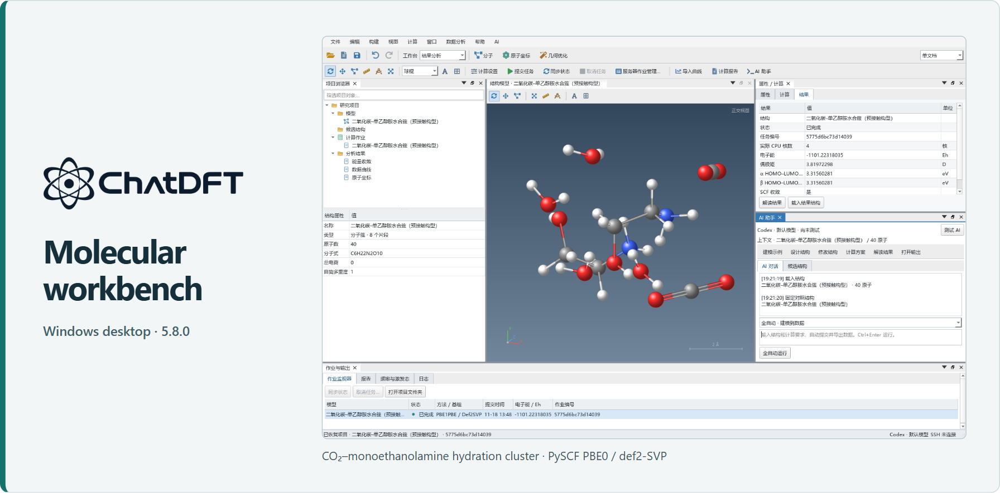
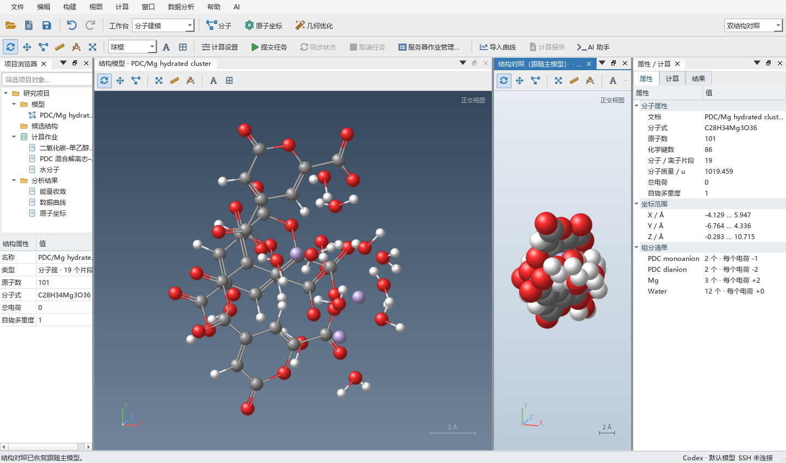

# ChatDFT

**面向计算化学的 Windows 科学计算工作台。** 从三维建模和 PySCF 计算，到图件、数据和报告。

**[下载 Windows 版 5.8.0](https://github.com/shaoyinzi654-source/ChatDFT/releases/download/v5.8.0-standalone/ChatDFT-Standalone-5.8.0-Windows.zip)**　·　[实机图集](#实机图集)　·　[使用指南](docs/workflow.md)　·　[English](README.en.md)

## 实机图集

点击图片查看原尺寸。图集包含三维建模界面、已归档的作业和实际计算输出。

<table>
  <tr>
    <td width="50%" valign="top">
       
      <strong>双视图建模</strong> 对照 PDC 镁离子水合簇的两种显示方式。
    </td>
    <td width="50%" valign="top">
       
      <strong>项目库</strong> 恢复结构和作业结果，打开独立的项目文件夹。
    </td>
  </tr>
  <tr>
    <td width="50%" valign="top">
       
      <strong>电子结构图件</strong> 查看 SCF 能量、Mulliken 原子电荷和前线轨道能级。
    </td>
    <td width="50%" valign="top">
       
      <strong>AI 分析报告</strong> 汇总计算条件、几何核对、结果和解释边界。
    </td>
  </tr>
  <tr>
    <td width="50%" valign="top">
       
      <strong>结构图导出</strong> 留存三维几何和 Å 坐标，便于复核计算输入。
    </td>
    <td width="50%" valign="top">
       
      <strong>AI 补充出图</strong> 依据计算数据汇总胺、CO₂ 和水的片段电荷。
    </td>
  </tr>
</table>

## 工作台功能

- **分子搭建与编辑** · SMILES、XYZ、非周期 XSD；多分子、离子及显式水组装；原子坐标编辑、撤销重做、距离和角度测量。
- **AI 建模和澄清** · 使用本机 Codex 或兼容 API 规划结构、排布和计算设置，条件不明确时可追问。
- **PySCF 计算** · 通过 SSH 运行单点能、几何优化、谐振频率、优化加频率和垂直激发态，支持气相和 IEF-PCM 溶剂设置。
- **作业管理** · 查队列、运行进度及日志；取消或重试作业；按编号恢复初始模型和结果结构。
- **分析和归档** · 保存 XYZ、原始 JSON、CSV、PNG、SVG 和 Markdown，实算结果可用于收敛、距离及 RMSD 检查。AI 补充图、报告及相关作图数据按版本保存。
- **论文与周期体系** · 分子论文可从原文提取方案并核对条件。PDC 周期水溶液由独立的 GROMACS 工作流建盒、分析和管理轨迹，需按指南取得原始参数。

## 安装与启动

1. [下载并解压 Windows 安装包](https://github.com/shaoyinzi654-source/ChatDFT/releases/download/v5.8.0-standalone/ChatDFT-Standalone-5.8.0-Windows.zip)，安装 **64 位 Python 3.13**。
2. 在解压目录用 PowerShell 运行 `.\Install-ChatDFT.ps1`，然后打开桌面快捷方式。
3. 选择 **构建 → 从 SMILES 建模**，输入 `O` 即可预览水分子。提交计算前，在 **计算 → 连接与模型设置** 配置自己的 PySCF 服务器。

[试跑一个全自动作业](docs/workflow.md) · [看实际结果图](docs/workflow.md#查看输出) · [完整工作台说明](standalone/README.md)

## 项目资料

[Windows 源码](standalone/) · [版本发布](https://github.com/shaoyinzi654-source/ChatDFT/releases) · [PDC 分子动力学](standalone/PDC-MD-GUIDE.md) · [早期浏览器版](legacy/browser/) · [许可证](LICENSE)

[项目官网](https://chatdft.com/) · [报告问题](https://github.com/shaoyinzi654-source/ChatDFT/issues) · [第三方来源说明](standalone/OPEN_SOURCE.md)
