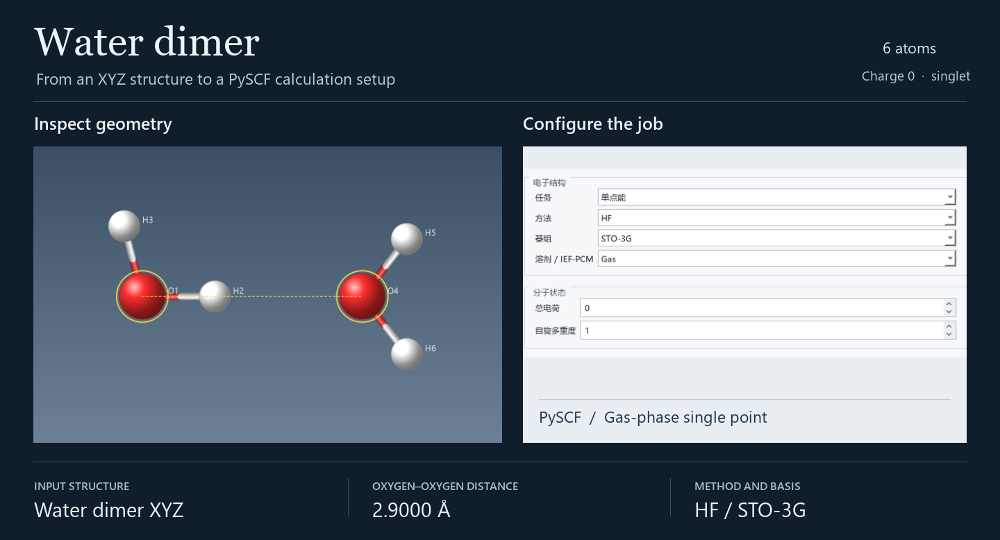

<h1 align="center">
  <picture>
    <source media="(prefers-color-scheme: dark)" srcset="docs/images/wordmark-paper.png">
    
  </picture>
</h1>

<p align="center"><strong>分子建模、PySCF 计算与结果分析的 Windows 工作台</strong></p>

<p align="center">
  <strong><a href="https://github.com/shaoyinzi654-source/ChatDFT/releases/download/v5.8.0-standalone/ChatDFT-Standalone-5.8.0-Windows.zip">下载 Windows 5.8.0</a></strong>
  &nbsp;·&nbsp; <a href="#安装与上手">安装与上手</a>
  &nbsp;·&nbsp; <a href="#实算案例">实算案例</a>
  &nbsp;·&nbsp; <a href="#文档与支持">文档</a>
  &nbsp;·&nbsp; <a href="README.en.md">English</a>
</p>

[](#安装与上手)

## 从结构到计算结果

在本地载入结构，设定方法与体系参数，经 SSH 提交 PySCF 作业。结果同步回工作台后，可对照初始与结果结构、查看数值和收敛曲线，并从项目库打开归档文件。

[](#功能与工作流)

| 你想做什么 | 从这里开始 |
| --- | --- |
| 第一次打开 ChatDFT | [安装并跑一个水二聚体作业](#安装与上手) |
| 看一份已完成作业的输入与输出 | [CO₂–单乙醇胺水合簇](#实算案例) |
| 确认任务、格式或工具是否适用 | [功能与工作流](#功能与工作流) |
| 查服务器设置、输出文件或论文复现 | [文档与支持](#文档与支持) |

## 安装与上手

1. 安装 **64 位 Python 3.13**，下载并解压 [Windows 5.8.0 ZIP](https://github.com/shaoyinzi654-source/ChatDFT/releases/download/v5.8.0-standalone/ChatDFT-Standalone-5.8.0-Windows.zip)。
2. 在解压目录打开 PowerShell，运行下列命令，然后打开桌面的 **ChatDFT** 快捷方式。

   ```powershell
   .\Install-ChatDFT.ps1
   ```

3. 通过 **文件 → 导入结构** 打开水二聚体 XYZ。选择两个氧原子，核对 O···O 初始间距 **2.9000 Å**。
4. 要提交作业，在 **计算 → 连接与模型设置** 填写 SSH 和服务器上的 PySCF Python 路径，再设置 **气相 HF/STO-3G 单点能**，电荷 0，多重度 1。

<p>
  <a href="docs/images/water-dimer-measurement.png"></a>
  &nbsp;
  <a href="docs/images/pyscf-job-setup.png"></a>
</p>

[下载示例 XYZ](docs/examples/water-dimer/water-dimer.xyz?raw=1) · [水二聚体操作步骤](docs/examples/water-dimer/)

## 实算案例

### CO₂–单乙醇胺水合簇

这份已归档的作业包含一个 **40 原子、电中性、单重态**水合簇。PySCF 对给定构型执行了 **PBE0/def2-SVP 气相单点计算**。

[](docs/images/workbench-5.8.png)

| 操作 | 在工作台里核对 |
| --- | --- |
| 打开结构 | 核对原子数、总电荷、多重度及当前模型。 |
| 核对计算设置 | 检查 PBE0、def2-SVP、气相和单点能设置。 |
| 阅读结果 | 核对 SCF 收敛、电子能、偶极矩和前线轨道间隙。 |
| 回查文件 | 在项目库打开该作业，查看可用的坐标、输出、图件和分析报告。 |

<p>
  <a href="docs/images/hydrated-cluster-geometry.png"></a>
  &nbsp;
  <a href="docs/images/fragment-charge.png"></a>
</p>

左图用 XYZ 坐标绘制结构。右图把同一次计算的 Mulliken 原子电荷按片段求和。需要检查构型稳定性时，可继续做几何优化与振动分析。

[查看图集中的作业图件](docs/gallery.md#计算与分析) · [查看完整 SCF、电荷和轨道图](docs/images/calculation-output.png)

## 功能与工作流

### 分子建模

用 SMILES 生成三维构象，或导入 XYZ、非周期 XSD。可以调整原子坐标、电荷与多重度，给多片段体系设置初始间距，再测量距离、角度或二面角。双视图可以固定对照结构，并分别切换球棍、棍状、线框和空间填充样式。

[](docs/gallery.md#视角演示)

### 量子化学计算

| PySCF 任务 | 常用输出 |
| --- | --- |
| 单点能 | 给定几何的电子能、SCF 记录及可用的电荷和轨道数据 |
| 几何优化 | 优化后坐标、收敛状态及初始与结果结构的差异 |
| 谐振频率或优化加频率 | 振动频率及可用光谱数据 |
| 垂直激发态 | 给定几何的激发能及相关输出 |

适用任务支持气相或 IEF-PCM 溶剂模型。工作台可同步、取消或重试作业。已有 DOS 或光谱数据时，可以导入 CSV 曲线查看。

### AI 辅助与全自动计算

可使用已登录的本机 Codex 或兼容 API。AI 可以分别协助设计结构、修改构型、填写计算建议，也可以在验证建模后提交一次全自动作业。模型需要补充条件时，可以在原会话里回答并继续。

<details>
<summary>展开一条可复制的全自动提示词</summary>

```text
全自动：从 SMILES O 建立单个水分子，电荷 0，多重度 1。
执行气相 HF/STO-3G 单点能，归档电子能、偶极矩、原子电荷、结构图和报告。
```

</details>

[全自动作业步骤与示例](docs/workflow.md)

### 作业与项目

作业监视器显示任务状态、方法、基组和可用结果。项目库可以找回初始与结果结构、打开输出目录、查看日志并读取已有报告。基础图件随作业归档。补充分析将所用的作业数据和新图件按版本保存。

[](docs/gallery.md#项目与报告)

### 论文与周期体系

分子论文工作流可从 PDF、TXT 或 Markdown 提取方法、基组、分子状态及原文页码。周期 PDC 溶液由 GROMACS 工作流处理，涵盖周期盒、轨迹管理和聚集统计。复现前需要核对原始坐标、力场参数和模拟条件。

[论文工作流说明](standalone/README.md#ai-与服务器) · [PDC 分子动力学指南](standalone/PDC-MD-GUIDE.md)

## 实机图集

[双视图旋转演示](docs/gallery.md#视角演示) · [建模与测距](docs/gallery.md#建模--modeling) · [计算与分析](docs/gallery.md#计算与分析) · [项目库与报告](docs/gallery.md#项目与报告)

## 文档与支持

| 文档 | 可查内容 |
| --- | --- |
| [工作台手册](standalone/README.md) | 界面、建模、模型和服务器设置 |
| [全自动计算指南](docs/workflow.md) | 提示词、计算提交及报告归档 |
| [公开示例](docs/examples/) | 可下载输入的水二聚体及已完成的水合簇计算 |
| [版本发布](https://github.com/shaoyinzi654-source/ChatDFT/releases) | 安装包与版本记录 |
| [问题反馈](https://github.com/shaoyinzi654-source/ChatDFT/issues) | 报告复现步骤、版本和相关错误 |

[源码](standalone/) · [官网](https://chatdft.com/) · [许可证](LICENSE) · [开源组件与来源](standalone/OPEN_SOURCE.md) · [早期浏览器版](legacy/browser/)
