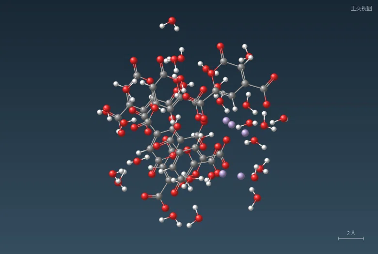

# PDC–镁显式水组装 / PDC–magnesium hydration assembly

[下载 ChatDFT 项目](pdc-hydration.chatdft.json?raw=1) · [下载 XYZ 坐标](pdc-hydration.xyz?raw=1) · [仓库首页](../../../README.md)

这是用 ChatDFT 分子组装功能离线生成的初始构型。它包含 **186 个原子、42 个分子与离子组分**，总电荷为 0，自旋多重度为 1。原子坐标以 Å 为单位。

| 组分 / Component | 数量 / Count | 形式电荷 / Charge per fragment |
| --- | ---: | ---: |
| PDC²⁻ | 6 | −2 |
| Mg²⁺ | 6 | +2 |
| H₂O | 30 | 0 |

## 约束与核对 / Placement and checks

| 配方中的组分编号 | 初始几何 |
| --- | --- |
| PDC 2 → 1、4 → 3 | 两组近似平行堆叠。重原子拟合平面的法向间距为 3.60 Å。 |
| Mg 7–11 → PDC 1–5 | 各镁到对应 PDC 中第 4 个氧的距离为 2.25 Å。 |
| 水 13–17 → Mg 7–11 | 各水氧到对应镁的距离为 2.30 Å。 |
| 其余组分 | 使用组装器的无重叠搜索生成初始位置。 |

1. 在 **文件 → 打开 ChatDFT 项目** 加载项目。从左侧属性确认原子数、电荷和自旋。项目文件保留组分、键连接和建模配方。
2. 切换双结构对照，在一侧用球棍检查原子与键，另一侧用空间填充检查空间占据。需要核查距离时，打开测距工具并依照配方中的组分和锚点选原子。
3. 在 **计算设置** 中核对方法、基组、溶剂和服务器资源。此文件提供的是非周期初始构型。若要获得优化结构或计算结果，需在所选方法下另行运行作业。

播放 360° 结构旋转 / Rotate the assembled cluster

 

The downloadable project contains an independently generated, nonperiodic starting geometry with six PDC dianions, six Mg²⁺ ions, and 30 explicit water molecules. It retains fragment identities, bonds, and the assembly recipe. Its two stacking separations and ten Mg–O contacts were checked against the saved coordinates. Open the project to inspect or measure it, then choose simulation settings for your intended calculation.

[Full-size workbench views](../../images/pdc-hydration-assembly.png) · [Completed PySCF example](../../../README.en.md#completed-calculation) · [Periodic PDC workflow](../../../standalone/PDC-MD-GUIDE.md)
