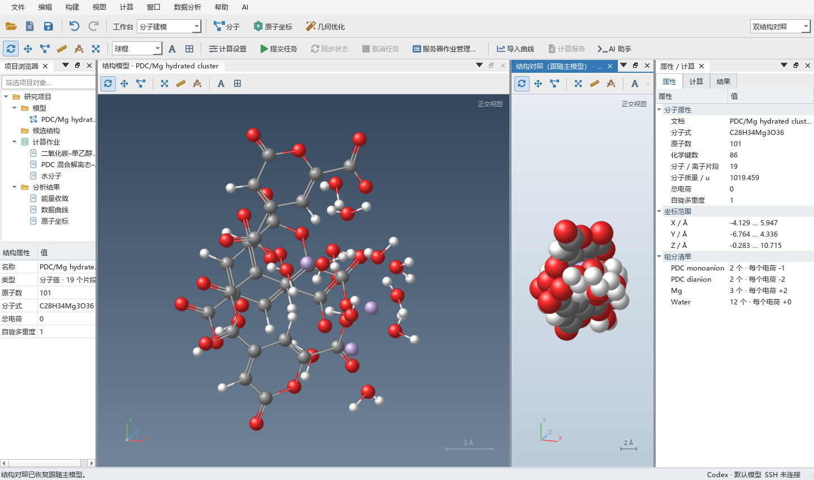
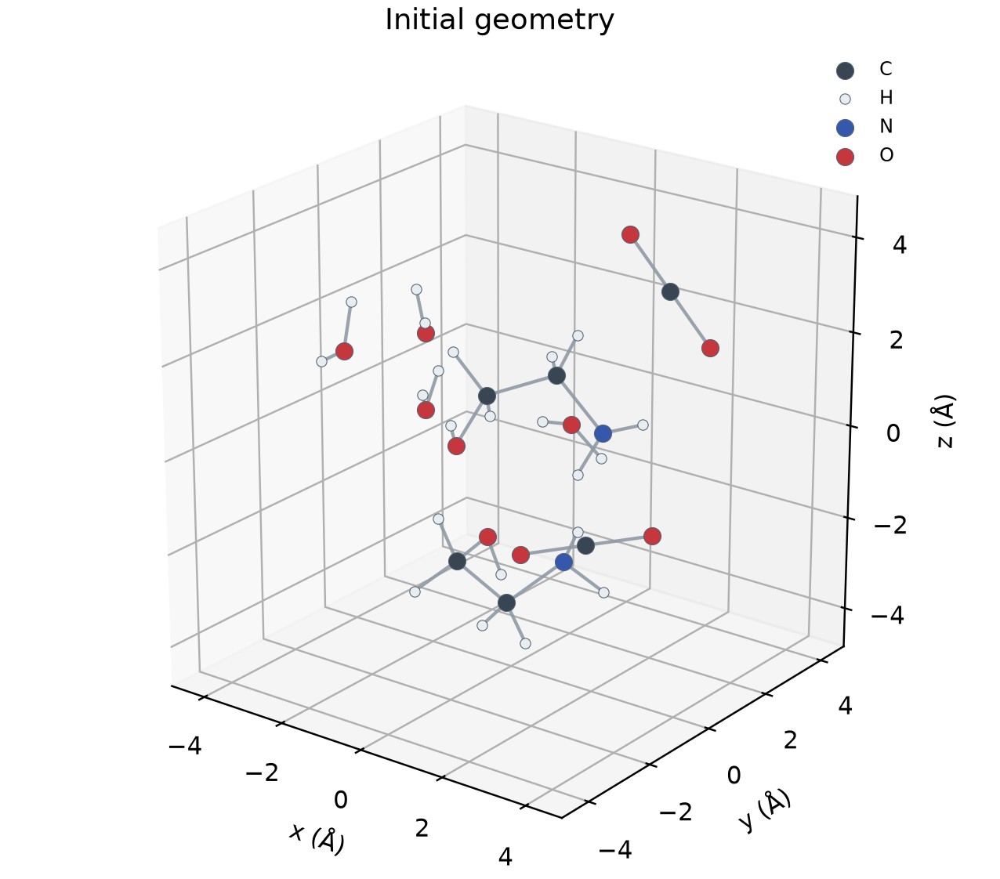
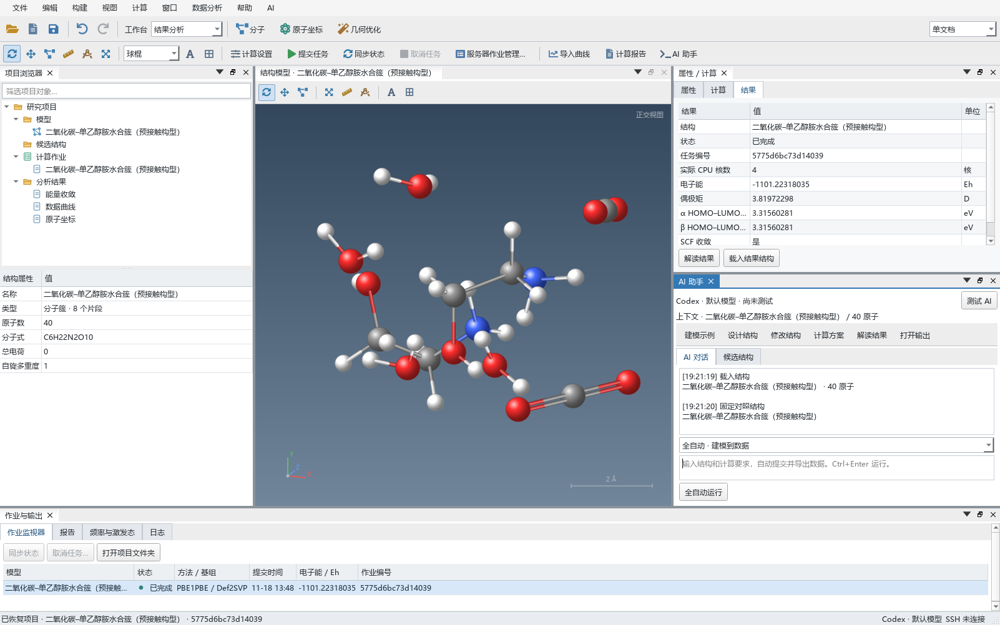
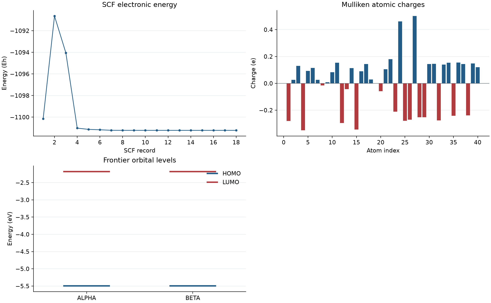
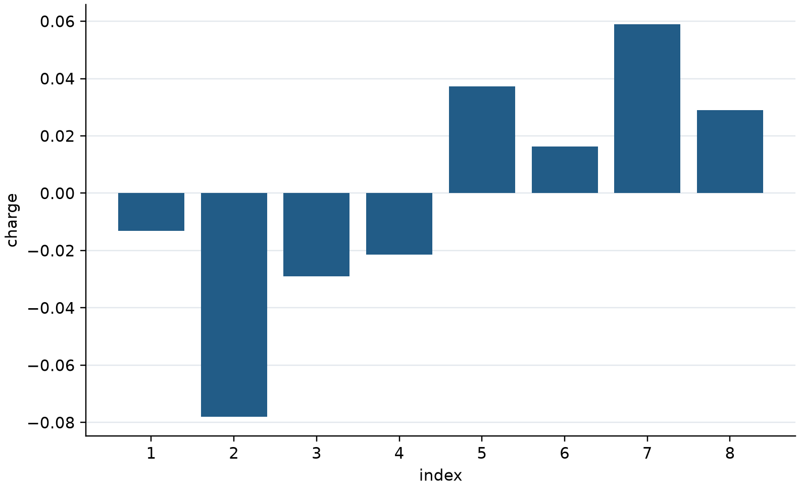
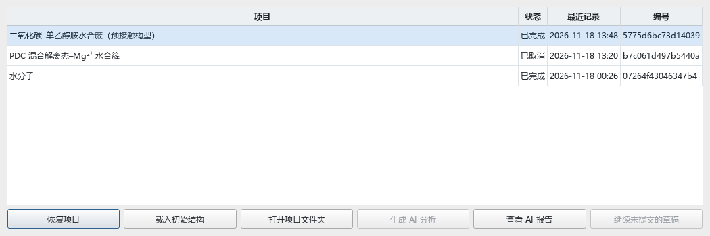
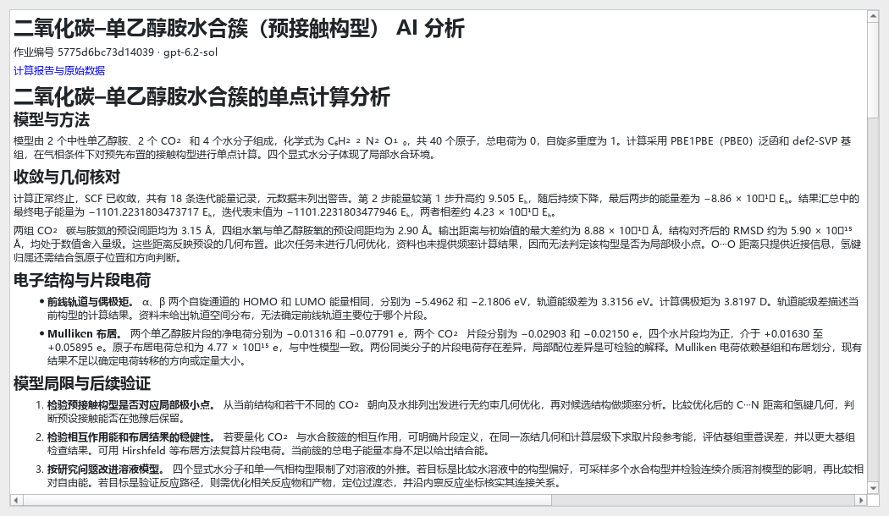

# ChatDFT 实机图集 / Gallery

[仓库首页](../README.md) · [English README](../README.en.md) · [全自动计算指南](workflow.md)

## 建模 / Modeling

### PDC–镁离子水合簇

同一构型在两个视窗使用不同的显示方式。球棍图适合查看成键关系，空间填充图用于观察原子占据的空间。

### 导出的三维结构

结构图可和 XYZ 坐标一起保留，便于从计算输入重新绘制。

## 计算与分析 / Calculation and analysis

### CO₂–单乙醇胺水合簇单点计算

图中为 40 原子、总电荷 0、单重态的簇模型。使用 PySCF 在给定构型上进行 PBE0/def2-SVP 单点计算。

### SCF 收敛、原子电荷与轨道

SCF 曲线记录电子自洽迭代。Mulliken 电荷和轨道能量对应这一次计算采用的构型、方法和基组。

### 按分子片段汇总电荷

用同一作业的 Mulliken 数据按片段求和，查看水、CO₂ 和单乙醇胺各自的净电荷。

## 项目与报告 / Projects and reports

### 项目库

从已归档的作业恢复结构和计算结果，也可直接打开对应目录。

### 分析报告

补充报告与计算结果保存在一起。报告记录计算条件、几何检查和解释依据，项目目录保留相应数据。

[查看输出文件的用途](workflow.md#查看输出)
