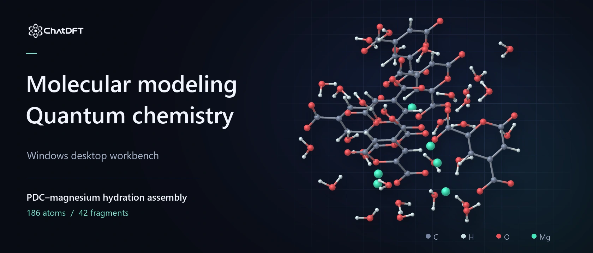

# ChatDFT gallery

## Hydration assembly

The assembly contains 186 atoms across six PDC dianions, six magnesium ions, and 30 water molecules. Download the native project to see the bonds, fragment definitions, and placement recipe in the workbench. [Assembly example](examples/pdc-hydration-assembly/)

## Calculation and analysis

The figures below come from a gas-phase PBE0/def2-SVP single-point calculation on a 40-atom CO₂–monoethanolamine hydration cluster.

The SCF curve follows successive electronic iterations. Mulliken charges and orbital energies depend on the geometry, method, and basis set. The fragment chart sums atomic charges for the water, CO₂, and monoethanolamine fragments. [Fragment charge chart](images/fragment-charge.png) · [Completed calculation walkthrough](../README.md#completed-calculation)

## Project outputs

Open a completed job in the project library to inspect the starting or final geometry, calculation log, values, and saved reports. Supplemental AI analysis may include a plot and an explanation of its data source. [Output files and their uses](workflow.md#output-files)
