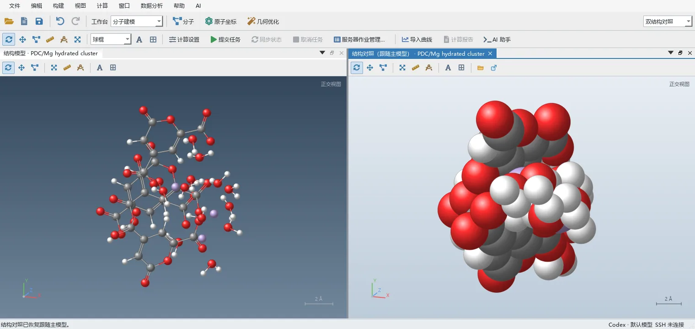

# ChatDFT 实机图集 / Gallery

[仓库首页](../README.md) · [English README](../README.en.md) · [全自动计算指南](workflow.md)

## 186 原子 PDC–镁显式水组装

6 个 PDC²⁻、6 个 Mg²⁺、30 个显式水。案例包含可打开的原生项目、XYZ、建模约束和旋转演示。

[查看案例与文件](examples/pdc-hydration-assembly/)

## 视角演示

同一个 PDC–镁水合簇在双视图中旋转。左侧球棍图保留成键关系，右侧空间填充图展示相同构型的占据空间。

播放 5 秒工作台演示 / Play the 5-second demo

 

[查看静态原图](images/pdc-dual-view.png)

## 建模 / Modeling

### PDC–镁离子水合簇

同一构型在两个视窗使用不同的显示方式。球棍图适合查看成键关系，空间填充图用于观察原子占据的空间。

### 水二聚体测距

[打开水二聚体示例与坐标](examples/water-dimer/)

### 导出的三维结构

结构图可和 XYZ 坐标一起保留，便于从计算输入重新绘制。

## 计算与分析

### PySCF 输入

在提交窗口核对结构、方法、基组和分子状态后，再提交服务器。

### CO₂–单乙醇胺水合簇单点计算

图中为 40 原子、总电荷 0、单重态的簇模型。使用 PySCF 在给定构型上进行 PBE0/def2-SVP 单点计算。

[在首页跟读实算案例](../README.md#实算案例)

### SCF 收敛、原子电荷与轨道

SCF 曲线记录电子自洽迭代。Mulliken 电荷和轨道能量对应这一次计算采用的构型、方法和基组。

### 按分子片段汇总电荷

用同一作业的 Mulliken 数据按片段求和，查看水、CO₂ 和单乙醇胺各自的净电荷。

## 项目与报告

### 项目库

从已归档的作业恢复结构和计算结果，也可直接打开对应目录。

### 分析报告

补充报告与计算结果保存在一起。报告记录计算条件、几何检查和解释依据，项目目录保留相应数据。

[查看输出文件的用途](workflow.md#查看输出)
