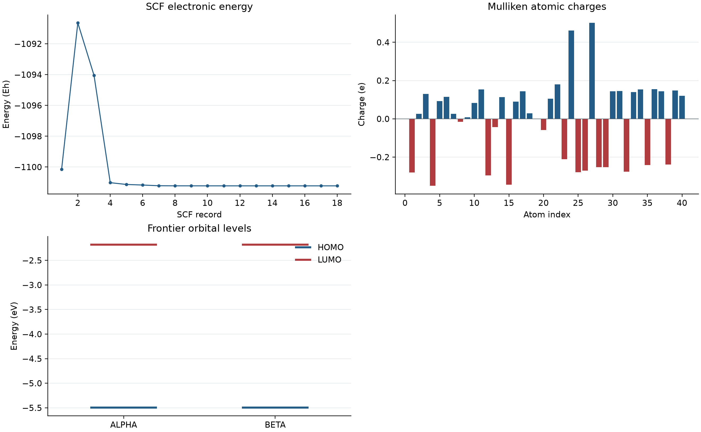

# ChatDFT 全自动计算指南

全自动模式把三维建模、计算提交、结果同步和归档串成一次运行。开始前，在 **计算 → 连接与模型设置** 选好 AI 与 SSH 服务器，并核对服务器的 PySCF Python 路径。

## 提交作业

1. 打开 **AI → 全自动计算**。在提示词中写清组成、构型约束、总电荷、自旋多重度，以及要执行的计算方法和任务类型。
2. 若软件需要澄清分子或几何约束，按提示补充后继续。确认 SSH 登录后，工作台提交作业并跟踪排队或运行状态。
3. 完成后从 **文件 → 项目库** 选中作业。可以恢复初始结构或计算结果，打开项目目录，也可以生成补充 AI 分析。

用水分子示例验证从建模到导出的流程。

```text
全自动：用 SMILES O 新建单个水分子，电荷 0，多重度 1。用 PySCF 在气相做 HF/STO-3G 单点能。输出最终电子能、偶极矩、原子电荷、结构图和计算报告。
```

用水合簇示例观察几何优化后的接触位置。

```text
全自动：创建尿素二聚体水合簇。按顺序放入两个尿素（1–2 号，SMILES NC(N)=O）和四个水（3–6 号，SMILES O）。让 2 号尿素的第一个氮距 1 号尿素羰基氧 3.05 Å。3、4 号水氧距 1 号羰基氧 2.90 Å，5、6 号水氧距 2 号羰基氧也为 2.90 Å。核对 28 个原子、电荷 0、多重度 1。运行气相 B3LYP/6-31G(d) 几何优化，关闭附加色散。汇总收敛、RMSD、接触距离及对应图表。
```

## 查看输出

| 内容 | 用途 |
| --- | --- |
| 初始结构与结果结构 | 使用 XYZ 或 ChatDFT 项目文件追溯结构来源。 |
| 输入、日志及结果 JSON | 核对计算方法、基组、收敛状态与服务器实际输出。 |
| CSV、PNG、SVG | 保存计算和分析中的数值，以及可编辑的矢量图。图表类型随作业实际返回的数据而定。 |
| 计算报告与 AI 分析 | 基础报告由实际输出生成。补充 AI 分析会记录使用的数值、假设和局限，并单独保存版本。 |



*实算示例为 CO₂–单乙醇胺水合簇的单点结果。单点计算对应给定几何。需要验证构型是否稳定时，应使用适当的几何优化与振动分析。*

[返回仓库首页](../README.md) · [完整工作台说明](../standalone/README.md) · [PDC 分子动力学指南](../standalone/PDC-MD-GUIDE.md)
